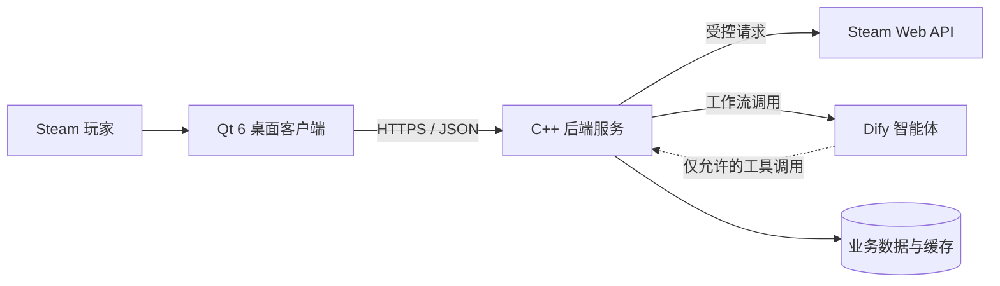

# Intelligent Recommend System

一款面向 Steam 玩家的桌面智能推荐与数据可视化应用。项目希望把分散的游戏库、游玩时长和偏好数据整理成易于理解的图表，并通过一个“资深玩家”智能体，让用户通过自然语言获得有依据、可解释的游戏推荐。

> 项目目前处于早期开发阶段。Qt 客户端骨架已经建立，Steam 数据接入、后端服务、可视化看板和 Dify 工作流仍在规划或开发中。

## 项目目标

- 帮助玩家快速了解自己的游戏库、游玩习惯和类型偏好。
- 结合用户主动描述的需求与获得授权的 Steam 数据提供个性化推荐。
- 展示推荐理由和匹配依据，而不只返回游戏名称列表。
- 通过前后端分离和虚拟机部署，练习较完整的桌面应用、服务端和 AI 工作流开发流程。
- 在学习项目中建立清晰的数据边界、权限控制和可验证的工程规范。

## 当前进度

| 模块 | 状态 | 说明 |
| --- | --- | --- |
| Qt 客户端骨架 | 已建立 | 已有应用入口、基础导航布局、资源系统和无边框窗口相关代码 |
| C++ 后端 | 待开发 | `backend/` 目前仅保留 CMake 占位文件 |
| Steam 数据接入 | 待开发 | 尚未实现账户绑定、Steam Web API 调用和数据模型 |
| 数据可视化 | 待开发 | 尚未实现游戏库、时长和偏好图表 |
| Dify 智能体 | 待开发 | 尚未建立工作流、提示词、知识库或受限工具接口 |
| 自动化测试与部署 | 待开发 | 尚未形成完整测试、CI 和 Linux VM 部署流程 |

当前界面中的“首页”“推荐”“小智”和用户区域属于导航原型，不代表对应业务已经完成。

## MVP 功能

首个可用版本计划形成以下闭环：

1. 用户绑定 Steam 身份，并明确授权应用读取可访问的数据。
2. 后端获取公开或已授权的个人资料、游戏库和游玩数据。
3. 客户端用简洁图表展示游戏数量、游玩时长、偏好分布和近期活动。
4. 用户通过会话描述预算、类型、游玩人数、设备和时间等需求。
5. Dify 工作流结合用户输入与后端提供的受限数据生成候选游戏。
6. 客户端展示推荐结果、匹配依据、限制条件和推荐理由。

当 Steam 资料不可见、接口受限或用户未授权时，系统应明确提示数据缺失，并降级为仅根据用户主动输入的偏好进行推荐。

## 系统架构

首期平台为 Windows 桌面客户端和部署在 Linux 虚拟机中的 C++ 后端。Qt 客户端不直接连接 Steam 或 Dify，也不保存服务端密钥。



### 模块职责

#### Qt 客户端

- 负责界面展示、输入校验、导航、图表和会话交互。
- 只通过后端公开接口访问业务数据。
- 不保存 Steam API Key、Dify API Key 或数据库凭据。
- 不在 UI 线程执行阻塞网络请求或长时间计算。

#### C++ 后端

- 作为客户端、Steam、Dify 和数据存储之间的唯一可信边界。
- 负责身份认证、资源授权、输入校验、数据聚合、缓存和审计。
- 保管外部服务凭据，并限制每个用户可访问的数据范围。
- 向 Dify 暴露白名单化的工具，而不是数据库或任意内部接口。

#### Dify 智能体

- 通过提示词、工作流和模型包装“资深玩家”推荐角色。
- 使用后端提供的最小必要上下文和受限工具获取用户数据。
- 生成候选结果和解释，但不负责最终身份认证、权限判断或高权限操作。
- 模型输出始终视为不可信输入，由后端校验后再交给客户端展示或执行。

#### Python 扩展

Python 不是首期核心服务语言。只有当 Dify 自定义工具、模型 SDK 或离线数据处理确有需要时，才增加独立、边界清晰的 Python 模块；认证、授权和核心业务规则仍由后端掌控。

## 技术栈

### 当前已使用

- C++20
- Qt 6 Widgets
- Qt Core、Gui、Widgets、Network
- CMake 3.24+
- QWindowKit

### 计划使用

- Linux VM 上的 C++ 后端服务
- Steam Web API 与 Steam 身份绑定流程
- Dify 工作流和模型服务
- 可替换的数据存储与缓存方案
- 必要时使用 Python 编写智能体工具或数据处理任务

后端框架、数据库、图表组件和部署方式尚未最终选型。引入前应先明确维护成本、许可证、跨平台支持和安全影响。

## 数据流与安全边界

- 客户端只持有用户会话所需的短期凭据，不包含 Steam、Dify 或数据库服务密钥。
- 所有资源访问均由后端根据当前用户身份执行授权，不能仅依赖前端传入的 Steam ID。
- Dify 只能调用明确登记的后端工具；工具必须校验身份、参数、数据范围、超时和返回体大小。
- 不将完整令牌、私密个人资料、无界游戏库数据或原始模型上下文写入日志。
- 外部 API 响应、提示词内容和模型结果均按不可信输入处理。
- 用户应能知道数据来源、授权范围以及数据不可用时的降级行为。
- 推荐结果仅供参考；价格、平台支持和游戏状态等信息在展示前应由可靠数据源重新确认。

## 仓库结构

```text
Intelligent-recommend-system/
├── frontend/              # Qt 6 Windows 桌面客户端
│   ├── resources/         # Qt 资源和界面图标
│   ├── src/               # 客户端源码与 UI
│   └── CMakeLists.txt
├── backend/               # 计划中的 Linux C++ 后端
├── 3rdParty/              # 第三方依赖及其许可证
├── AGENTS.md              # 本项目的开发与协作规则
├── AGENTS.universal.md    # 通用规则母版，不直接作为项目规则加载
└── README.md
```

## 前端开发

### 环境要求

- Windows 10/11
- 支持 C++20 的 MSVC 工具链
- Qt 6（当前开发环境使用 Qt 6.8 系列）
- CMake 3.24+
- Ninja 或其他受 CMake 支持的生成器
- 与当前 Qt 和编译器配置匹配的 QWindowKit

### 预期配置方式

以下命令展示预期参数结构。请用本机实际路径替换占位符，不要把个人机器的绝对路径提交到 CMake 文件中。

```powershell
cmake -S frontend -B frontend/cmake-build-debug -G Ninja -DCMAKE_BUILD_TYPE=Debug -DCMAKE_PREFIX_PATH="<QT_ROOT>" -DQWindowKit_DIR="<PROJECT_ROOT>/3rdParty/debug/qwindowkit/lib/cmake/QWindowKit"
cmake --build frontend/cmake-build-debug --target recommendation_client --config Debug
```

运行程序前，需要保证 Qt 和 QWindowKit 的运行时动态库能够被系统找到。

### 已知构建限制

当前仓库中的 QWindowKit CMake 导出配置尚不能稳定完成配置：`QWindowKitConfig.cmake` 可能无法正确包含同目录下的 `QWindowKitTargets.cmake`。因此现阶段不能保证上述命令直接构建成功。该问题属于既有依赖配置问题，修复时应优先重新生成或修正第三方包的安装导出流程，而不是在项目源码中硬编码开发机路径。

后端尚未建立可构建目标，因此暂不提供后端构建和运行命令。

## 开发约定

- 开始修改前阅读根目录 [AGENTS.md](AGENTS.md)。
- 保持客户端、后端和智能体工具之间的职责边界，不绕过后端直接访问外部服务。
- 新增 Qt 源码、UI 或资源时同步更新 CMake 和 QRC 清单。
- 新增外部依赖时记录来源、版本和许可证，不提交无来源的二进制文件。
- 提交前检查差异、构建或测试结果，并明确尚未验证的部分。

## 路线图

- [x] 阶段 0：建立 Qt 客户端、基础窗口和导航骨架。
- [ ] 阶段 1：定义后端接口与数据模型，完成 Steam 身份绑定和基础数据读取。
- [ ] 阶段 2：完成游戏库、游玩时长、偏好分布和近期活动看板。
- [ ] 阶段 3：接入 Dify，完成对话推荐、受限工具调用和推荐解释。
- [ ] 阶段 4：补齐异常降级、隐私设置、自动化测试和 Linux VM 部署。
- [ ] 阶段 5：根据实际使用反馈改进推荐质量、缓存策略和可观测性。

## 许可证

项目自身的开源许可证尚未确定。在许可证明确前，请勿假定项目代码可以被任意复制、分发或用于商业用途。第三方组件继续遵循各自许可证，相关声明应保留在 `3rdParty/` 中。
